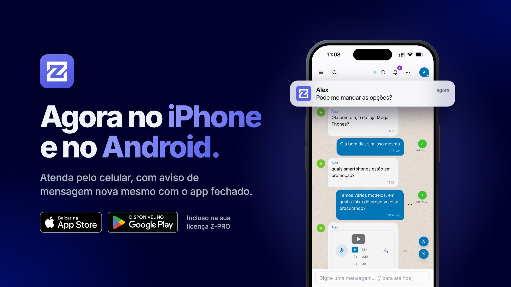

Copiar

Nesta página

1. [Ferramentas Adicionais e Integrações](/ferramentas-adicionais-e-integracoes/visao-geral-ferramentas-adicionais-e-integracoes)

# Como baixar e usar o app do Prismabot no celular (Android e iPhone)

Como baixar o app do Prismabot na Google Play ou na App Store, conectar ao seu painel e receber aviso de mensagem nova no celular

Com o app para Android e iPhone, você atende pelo celular com o painel completo, nas mesmas telas do navegador, e recebe aviso de mensagem nova mesmo com o app fechado. No primeiro acesso, você informa o endereço do painel que usa no navegador, e o app se conecta a ele.

**Pré-requisitos:**

* Celular com **Android 7.0 ou mais novo**, ou **iPhone com iOS 15 ou mais novo**.
* O **endereço do seu painel** (o mesmo que você usa no navegador, começando com `https://`) e o seu **e-mail e senha** de acesso.
* Para receber notificações: a configuração do administrador da **Etapa 4**.

---

## Como funciona

* O app abre o seu painel com as mesmas telas do navegador: atendimentos, respostas rápidas, etiquetas, filas, transferência e o resto do sistema, conforme o seu perfil de acesso.
* Texto, foto, arquivo e áudio gravado saem direto do celular.
* Com o app fechado, a mensagem nova chega como notificação. Tocar nela abre a conversa.

**iPhone na União Europeia:** a App Store não oferece o app nos países da União Europeia. Nesses países, use o sistema pelo navegador ou pelo atalho na tela inicial, como explicado em [Notificações Aplicativo (web push)](/ferramentas-adicionais-e-integracoes/notificacoes-aplicativo-web-push).

---

## Etapa 1: Baixe o app

Instale o app pela loja do celular: **Google Play** no Android ou **App Store** no iPhone. Se não souber qual app baixar, peça o link ao administrador do sistema.

🔒 **Para o licenciado:** o app se chama **Prismabot: Atendimento multicanal**, é o mesmo para todos os licenciados e está incluso na licença, sem custo extra.

* Android: [Google Play](https://play.google.com/store/apps/details?id=br.com.zdg.app)
* iPhone: [App Store](https://apps.apple.com/br/app/z-pro-atendimento-multicanal/id6820971678)

Quem revende com a própria marca: na loja e no ícone do celular aparece **Prismabot**. Depois de conectar, o app mostra o nome e o logo do seu painel, e o login e o painel aparecem com a sua marca, como no navegador. Para os seus clientes, envie o link da loja junto com o endereço do painel.

## Etapa 2: Conecte ao seu painel

1. Abra o app. Na tela **Configurar servidor**, digite em **Endereço do servidor** o endereço do seu painel, o mesmo que você usa no navegador, começando com `https://` (exemplo: `https://app.suaempresa.com.br`).
2. Toque em **Salvar e conectar**.
3. Entre com o mesmo **e-mail e senha** que você usa no painel.

O endereço é o do painel da sua empresa. Se não souber qual é, peça ao administrador do sistema.

Atende em mais de um painel? Na tela de login do app, toque em **Trocar servidor** e informe o outro endereço.

## Etapa 3: Libere as permissões do celular

1. Quando o celular perguntar, **permita as notificações**. Sem essa permissão, o celular não avisa de mensagem nova.
2. **Microfone e câmera** são pedidos na primeira vez que você grava um áudio ou tira uma foto pelo app. Permita para conseguir enviar áudio e foto.

## Etapa 4: Ligue as notificações nos canais (administrador)

**Disponível no perfil: Administrador**

O app funciona sem esta etapa, mas o celular só avisa de mensagem nova com ela feita.

1. Em **Canais**, edite cada canal que deve avisar no celular, ligue **Habilitar Web Push** e salve.
2. Repita em todos os canais que devem avisar. Mensagem que entra por um canal com essa opção desligada não gera notificação.

Na primeira vez que alguém entra pelo app no seu painel, as notificações podem levar **até 1 hora** para começar a chegar.

🔒 **Para o licenciado (servidor):** as notificações do app exigem o sistema na **versão 4.0.4.5 ou mais nova** (recomendamos sempre a mais recente), o painel abrindo com `https://` e a licença ativa.

---

## Resumo

O que fazer

Onde

Baixar o app

**Google Play** (Android) ou **App Store** (iPhone)

Conectar ao painel

App: **Configurar servidor > Endereço do servidor > Salvar e conectar**

Trocar de painel

Tela de login do app: **Trocar servidor**

Ligar a notificação de um canal

Painel: **Canais >** editar o canal **> Habilitar Web Push**

Escolher o som das notificações

Painel: botão de som ao lado do sino

---

## Encerramento

Com o app conectado e o Web Push ligado nos canais, a equipe acompanha os atendimentos longe do computador e responde assim que a mensagem chega.

---

## Possíveis Erros e Soluções

### O app não aparece na loja

**Causa:** celular com versão abaixo do mínimo, ou iPhone com a App Store de um país da União Europeia.
**Solução:** confira se o celular tem Android 7.0 ou mais novo, ou iOS 15 ou mais novo. Na União Europeia, use o sistema pelo navegador ou pelo atalho na tela inicial.

### O app não conecta ao painel

**Causa:** endereço diferente do usado no navegador, sem `https://` ou com erro de digitação, ou painel fora do ar.
**Solução:** abra o painel no navegador do celular e copie o endereço exatamente como aparece, começando com `https://`. Se nem pelo navegador o painel abrir, fale com o administrador do sistema.

### A notificação não chega

**Causa:** uma das condições da Etapa 3 ou da Etapa 4 não está atendida, ou o celular está segurando o aviso.
**Solução:** confira, nesta ordem:

1. A permissão de notificação do app está liberada nas configurações do celular.
2. O canal por onde a mensagem entrou está com **Habilitar Web Push** ligado.
3. Se for a primeira entrada pelo app neste painel, aguarde até 1 hora.
4. Você continua logado no app. Quem sai do sistema para de receber avisos naquele aparelho até entrar de novo.
5. **Foco** (iPhone) e **Não perturbe** estão desligados. Com eles ligados, a notificação vai direto para a Central de Notificações, sem aparecer na tela: confira a central antes de concluir que ela não chegou.
6. **Android:** a otimização de bateria pode segurar notificações em segundo plano. Nas configurações do celular, abra o app na lista de apps e, em **Bateria**, deixe **Sem restrições** (o caminho muda conforme a marca do aparelho).
7. Se tudo acima estiver certo, fale com o administrador do sistema para conferir se o sistema está atualizado.

### A notificação chega sem som

**Causa:** o botão de som ao lado do sino está em **grupos sem som** ou **tudo sem som**, ou o som está desligado nas configurações da empresa.
**Solução:** no painel, toque no botão de som ao lado do sino e escolha **som ligado** (disponível a partir da versão 4.0.6.8). Com o som da empresa desligado, o iPhone também fica em silêncio: nesse caso, fale com o administrador.

### Não consigo gravar áudio nem tirar foto

**Causa:** a permissão de microfone ou de câmera foi negada.
**Solução:** nas configurações do celular, abra o app na lista de apps e libere **Microfone** e **Câmera**.

[AnteriorLigações no Prismabot (Telefonia e Voz)](/ferramentas-adicionais-e-integracoes/ligacoes-no-z-pro-telefonia-e-voz)[PróximoNotificações Aplicativo (web push)](/ferramentas-adicionais-e-integracoes/notificacoes-aplicativo-web-push)

Atualizado há 9 dias

Isto foi útil?