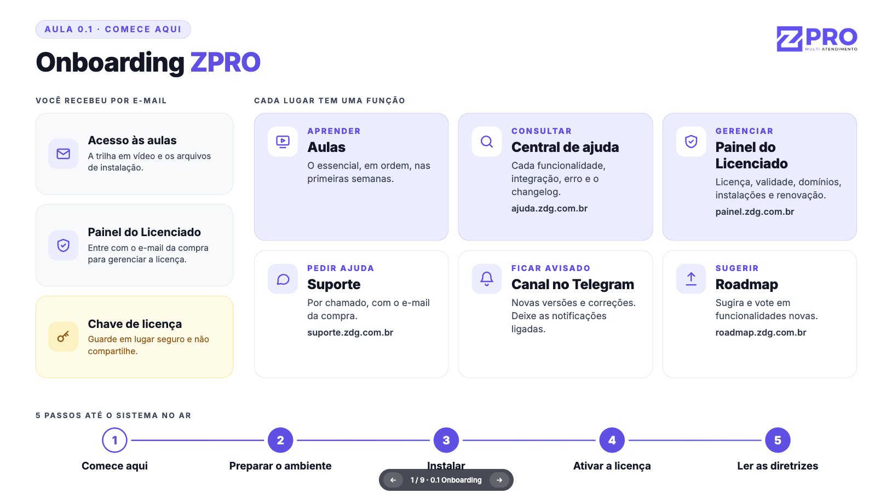

Copiar

Nesta página

1. [Primeiro Acesso](/primeiro-acesso/onboarding-novos-assinantes)

# Onboarding - novos assinantes

Primeiros passos após a compra do Prismabot: e-mail de boas-vindas, preparar o ambiente, instalar, ativar a licença e configurar o sistema.

Bem-vindo ao Prismabot. Este guia mostra o que você recebe após a compra, para que serve cada lugar que você vai usar e qual é o caminho, em 5 passos, até o sistema no ar.

Você também acompanha esses passos no [Painel do Licenciado](https://painel.zdg.com.br/), na aba **Onboarding**, que reúne os links de todos os portais citados aqui e onde você marca cada passo como concluído. Veja Painel do Licenciado.

---

#### Os e-mails que você recebe

Após a confirmação do pagamento, chegam três e-mails automáticos:

1. **Acesso às aulas** ([portal.zdg.com.br](https://prismatelecomservicos.com/ rel=)): a trilha em vídeo, o instalador e os arquivos de atualização.
2. **Acesso ao Painel do Licenciado** ([painel.zdg.com.br](https://painel.zdg.com.br/)): onde você gerencia a licença. Entre sempre com o e-mail da compra.
3. **Chave de licença:** o código que ativa o Prismabot depois de instalado. Sem ela não é possível usar o sistema, então localize esse e-mail e salve a chave para aplicar após a instalação.

**Cuidados com a chave de licença:**

* Guarde em local seguro. A chave fica **só no e-mail**, não no portal.
* **Não compartilhe:** toda instalação feita com a sua chave aparece na sua conta, no Painel do Licenciado.

Não recebeu algum dos e-mails? Verifique a caixa de spam. Se não estiver lá, abra um chamado administrativo em [suporte.zdg.com.br](https://prismatelecomservicos.com/ rel=) pedindo o reenvio.

---

#### Onde fica cada coisa

Onde

Para quê

**Portal** — [portal.zdg.com.br](https://prismatelecomservicos.com/ rel=)

Aprender em ordem e baixar o instalador e os pacotes de atualização

**Central de ajuda** — [ajuda.zdg.com.br](https://prismatelecomservicos.com/ rel=)

Pesquisar a documentação de cada funcionalidade e integração (muitos artigos têm vídeo), erros e o changelog

**Painel do Licenciado** — [painel.zdg.com.br](https://painel.zdg.com.br/)

Gerenciar a licença: visão geral, renovação, números, canais, domínios, atividades e o onboarding

**Suporte** — [suporte.zdg.com.br](https://prismatelecomservicos.com/ rel=)

Abrir chamado técnico ou administrativo e acompanhar as respostas

[**Telegram**](https://prismatelecomservicos.com/ rel=)

Avisos de novas versões, hotfixes e informações relevantes aos assinantes

**Roadmap** — [roadmap.zdg.com.br](https://prismatelecomservicos.com/ rel=)

Sugerir e votar em funcionalidades

Regra prática: aprenda o básico nas aulas do portal e, quando precisar de algo específico, pesquise aqui na central. O Painel do Licenciado funciona por fora da instalação, então você consegue gerenciar a licença mesmo com o servidor fora do ar.

---

#### Os 5 passos até o sistema no ar

**Passo 1 — Comece por aqui**

É este guia (e a aula 0.1 do portal). Siga as aulas do portal na ordem: elas foram montadas como uma trilha.

---

**Passo 2 — Prepare o ambiente**

Você vai precisar de:

* Uma servidor em nuvem com no mínimo **4 vCPUs, 16 GB de RAM e 200 GB de SSD**, com **Ubuntu 24.04 LTS sem painel** e arquitetura AMD, de preferência no Brasil.
* Dois subdomínios do **tipo A** apontados para o IP da servidor em nuvem: um para o sistema (ex.: `app.`) e outro para a API (ex.: `api.`). Se usa Cloudflare, deixe a nuvem **cinza** (sem proxy).

O passo a passo completo está em:

---

**Passo 3 — Instale o Prismabot**

Há dois caminhos:

* **Agendar com a nossa equipe:** abra um chamado em [suporte.zdg.com.br](https://prismatelecomservicos.com/ rel=) com o assunto **"Agendar instalação"** e envie os dados da servidor em nuvem e do domínio. O prazo é de **2 a 5 dias úteis** depois que os dados estiverem completos e corretos.
* **Instalar você mesmo:** com o instalador automático, disponível no portal. Leva poucos minutos se o ambiente estiver certo.

Se você nunca acessou um servidor por SSH, o agendamento é o caminho mais tranquilo. Nos dois casos a instalação segue o modelo padrão suportado pela Prisma Telecom. Instalação em Docker não faz parte do suporte.

---

**Passo 4 — Ative a licença**

Após a instalação, o sistema funciona, mas ainda sem licença ativa. Para ativar:

1. Acesse o painel com o usuário **Super Admin**.
2. No menu lateral, vá em **Tenants e Licenciamento → Assinatura**.
3. Insira a **chave de licença** recebida por e-mail.
4. Informe o **domínio principal** da instalação (o mesmo subdomínio do sistema configurado no Passo 2).
5. Salve para concluir a ativação.

O domínio informado na ativação deve ser **exatamente o mesmo** da instalação. Domínio diferente impede a ativação da licença.

Logo após a instalação, **troque as senhas padrão**. O passo a passo está em Manutenção e Segurança.

---

**Passo 5 — Leia as diretrizes da plataforma**

Antes de colocar clientes no sistema, leia três páginas:

* [Manutenção e Segurança: ações obrigatórias de segurança pós-instalação, firewall e backups](/diretrizes-e-politicas/manutencao-e-seguranca)
* [Política de Suporte Técnico: canais, horários, prazos e o que está incluso no suporte](/diretrizes-e-politicas/politica-de-suporte-tecnico)
* [Termos e Condições de Uso e Licenciamento](/diretrizes-e-politicas/termos-e-condicoes-gerais-de-uso-e-licenciamento)

---

#### Importante: duas datas diferentes

Data

O que é

Quando vence

**Validade da licença**

Sua assinatura anual

Você renova a assinatura

**Validade da versão**

O prazo de vida da versão instalada

O sistema **para**, mesmo com a licença em dia. É preciso atualizar

Na prática: **atualize o Prismabot pelo menos duas vezes por ano**. O aviso de cada versão nova sai no canal do Telegram. Veja mais em Gerenciar Licença Prismabot.

---

[AnteriorModels](/central-do-assinante/referencia-da-api/models)[PróximoPrimeiro Acesso ao Sistema](/primeiro-acesso/primeiro-acesso-ao-sistema)

Atualizado há 9 dias

Isto foi útil?